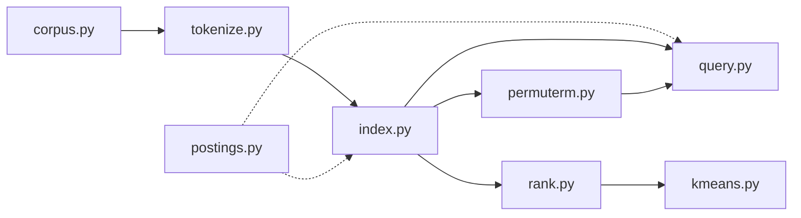

# ConspiraSE

Zero-dependency search engine with Boolean, wildcard and ranked retrieval plus topic clustering


## Features

- **Text normalization**: German umlaut folding, English and German stopwords removal
- **Boolean search**: supports AND, OR and AND NOT operators *(inverted index, postings list intersection)*
- **Ranking retrieval**: ranking results using TF-IDF weighting with cosine similarity *(vector space model)*
- **Wildcard queries**: supports one * i.e., (impf*, *impfung, ma*ia) and double * at both ends, for example *accin* *(permuterm index)*
- **Result clustering**: groups the top ranked tweets into themes, each labeled with its most typical words and its RSS *(k-means)*
- **Web interface**: a search page in a CRT terminal style, with highlighted matches and an animated spider that climbs over the results

## Quickstart

Requires Python 3.10+.

```bash
git clone https://github.com/pussinsneakers/ConspiraSE
cd ConspiraSE
python -m pip install -e .
```

Place your data file at `data/tweets.csv` (see [Data](#data) for the format).

### Command line

```bash
python -m conspirase.cli data/tweets.csv                   # Boolean search
python -m conspirase.cli data/tweets.csv --ranked          # ranked search, best matches first
python -m conspirase.cli data/tweets.csv --clusters 4      # top ranked results grouped into 4 themes
```

Building the index takes a few seconds. Then type a query at the prompt, or `quit` to exit.
Add `--limit N` to change how many results are shown (default 10).
See [Usage](#usage) for the query syntax.

### Web interface

```bash
python -m pip install -e ".[web]"                          # installs Flask
python -m conspirase.web data/tweets.csv
```

Open http://127.0.0.1:8000 in your browser. Use `--port` to pick another port, and
`--hide-handles` to show every author as `@user` (for screenshots).

## Usage

ConspiraSE has three search modes. **Boolean** (the default) returns every tweet that exactly
matches the query. **Ranked** and **Clusters** take plain words and return the closest tweets first.

### Boolean queries

| Syntax | Meaning | Example | Results |
|---|---|---|---|
| `a b` | implicit AND: both words must appear | `malaria vaccine` | 2 |
| `a AND b` | both words must appear | `malaria AND vaccine` | 2 |
| `a OR b` | at least one of the words | `malaria OR impfung` | 446 |
| `a NOT b` | first word, but not the second (same as `a AND NOT b`) | `vaccine NOT autism` | 89 |
| `NOT a` | every tweet without the word | `NOT impfung` | 108,252 |
| `pre*` | words starting with `pre` | `impf*` | 117 |
| `*suf` | words ending with `suf` | `*impfung` | 73 |
| `pre*suf` | words starting with `pre` and ending with `suf` | `ma*ia` | 492 |
| `*mid*` | words containing `mid` | `*accin*` | 169 |

Rules worth knowing:

- **Operators must be uppercase.** A lowercase `and` is treated as a word, and then dropped as a stopword.
- **Evaluation is left to right**, with no precedence and no parentheses:
  `impfung OR vaccine malaria` means `(impfung OR vaccine) AND malaria`.
- **Words match exactly after normalization.** Case and umlauts don't matter (`Impfung` = `impfung`,
  `Übergewicht` = `uebergewicht`), but there is no stemming: `impfung` does not find `impfungen`.
  Use a wildcard (`impfung*`) for that.
- **Stopwords are ignored**, so `side effects of vaccines` searches for `side effects vaccines`.
- **Wildcards** support one `*` anywhere, or a `*` at both ends. Patterns like `a*b*c` are rejected.

### Ranked and clustered queries

```bash
python -m conspirase.cli data/tweets.csv --ranked              # best matches first
python -m conspirase.cli data/tweets.csv --clusters 4          # top 50 matches grouped into 4 themes
```

Both treat the query as free text: every word counts, and operators and `*` have no effect.
To exclude words, filter with a Boolean query first.

### Example session

```text
$ python -m conspirase.cli data/tweets.csv --limit 2
INFO:conspirase.corpus:tweets.csv: kept 108313, skipped 0 malformed, 0 empty, 12115 duplicates
Number of documents in the corpus: 108313
Number of terms: 158023
What's your query hun? impf* AND nebenwirk*
The tweets matching the result: 1
User: @…, tweet: …
What's your query hun? malaria OR impfung
The tweets matching the result: 446
User: @…, tweet: …
User: @…, tweet: …
What's your query hun? a*b*c
Invalid query: Unsupported wildcard
What's your query hun? quit
```

## How it works



### Indexing 

Read the file line by line, for each line turn it into a Document object with ID, text and metadata (`corpus.py`). For the raw text, tokenize and normalize it, by lowercase, umlaut folding, stopwords removal and clearing out url links and @mentions (`tokenize.py`). Build an inverted index by iterating through the normalized terms (`index.py`) and adding terms doc IDs and corresponding term frequencies into postings list (`postings.py`). Each document gets a sequential internal ID, so every postings list stays sorted without any extra sorting. 

### Searching 

Parse the words in query identifying terms and operators, query terms are normalized in the same manner as documents (`query.py`). Operators are applied through the merge fucntions intersect, union, and-not (`postings.py`). Search performs left-to-right evaluation, with stopwords skipped. If term in query contains a wildcard, wildcard-prefix is searched in permuterm index rotations (`permuterm.py`), matching terms postings are combined with OR operator and the combined list counts as the results for the wildcard word.
In the rank mode, query and document terms are weighted with TF-IDF, documents are scored by cosine similarity with document norms computed once at startup (`rank.py`). After the search top k results are returned. Rank mode treats query as free text, without operations or wildcards. 

`cli.py` loads the data, builds the indexes and runs an interactive loop in Boolean or ranked mode. 

### Clustering

Cluster the top 50 ranked tweets by computing TF-IDF vector for every document. Vectors are computed using the same weights as ranking, normalized to length 1 and stored sparsely as a dictionary. K-means picks k random tweets as starting centers, then repeats: assigns every tweet to the nearest center (squared Euclidean distance), then moves each center to the average of its tweets. It stops once no tweet changes cluster. Each cluster is labeled with the 3 highest-weighted terms of its center, and its RSS (the sum of squared distances to the center) measures how tight it is. 

'engine.py' builds all indexes once and is shared by the CLI and the web server. 

'web.py' contains Flask API with /api/search returning JSON. In the web interface each tweet comes back as segments with the matching words marked, using the same normalization and permuterm expansion as search, so the highlighting always matches what the search actually found.

The page ('static/index.html') is plain HTML, CSS and JavaScript with no framework.

## Project structure

```text
conspirase/
├── src/package/
│   ├── corpus.py        # reads .csv/.tsv/.jsonl into Documents objects 
│   └── tokenize.py      # tokenizes raw text into the list of terms 
│   └── postings.py      # creates PostingsList object, containing all terms doc IDs and corresponding term frequencies 
│   └── index.py         # builds an inverted Index from the Document 
│   └── query.py         # searches the index for the documents with query terms and operator condition 
│   └── rank.py          # computes TF-IDF weights, score results using cosine similarity 
│   └── permuterm.py     # builds permuterm index, identifies the type of wilcard used and performs perm.index lookup
│   └── kmeans.py        # rank documents using TF-IDF weights and cosine similarity
│   └── cli.py           # enable interactive command-line search over a document collection
├── tests/
├── data/
└── pyproject.toml
```

## Running tests

```bash
pytest
```

## Data

The original corpus is a collection of tweets. However, due to Twitter's terms and policy, it is not included in the package.
Each line becomes one document, empty files and malformed lines are skipped.
### Supported data formats 
### tab-separated files (.csv/.tsv) in UTF-8 with columns in this order: timestamp, tweet id, user handle, username, tweet text. For example:
2018-02-19 22:57:45 +0100\t<tweet_id>\t@handle\tName\tText of the tweet

### JSON lines (.jsonl) in UTF-8 with required fields _id and text, any other field will be placed in meta attribute, e.g., 
{"_id": "1", "text": "Some text", "lang": "en"}

## Background

The project is based on the assignments from the Information Retrieval and Text Mining class at Stuttgart University. The class was built on top of Manning/Raghavan/Schütze: Introduction to Information Retrieval. 

## License

MIT, see [LICENSE](LICENSE).