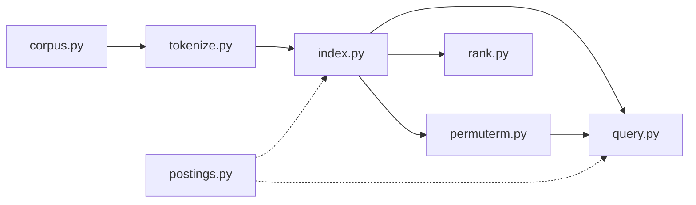

# ConspiraSE

Zero-dependency search engine with Boolean, wildcard and ranked retrieval plus topic clustering

<!--  -->

## Features

- **Text normalization**: German umlaut folding, English and German stopwords removal
- **Boolean search**: supports AND, OR and AND NOT operators *(inverted index, postings list intersection)*
- **Ranking retrieval**: ranking results using TF-IDF weighting with cosine similarity *(vector space model)*
- **Wildcard queries**: supports one * i.e., (impf*, *impfung, ma*ia) and double * at both ends, for example *accin* *(permuterm index)*

## Quickstart
Note: Requires Python 3.10+

```bash
git clone https://github.com/pussinsneakers/ConspiraSE
cd conspiraSE
python -m pip install -e .
```

Place your data file at `data/example.csv` (see [Data](#data)), then run:

```bash
python -m conspirase.cli data/tweets.csv                       # Boolean search
python -m conspirase.cli data/tweets.csv --ranked              # ranked search
python -m conspirase.cli data/tweets.csv --ranked --limit 5    # top 5 results only
```
Type a query at the prompt or quit to exit 
#here example of queries 

## Usage

| Syntax | Meaning | Example |
|---|---|---|
| `a b` | description | `foo bar` |
| `a AND b` | description | `foo AND bar` |
| `a OR b` | description | `foo OR bar` |
| `pre*` | description | `exam*` |

Example session:

```text
> example input
3 results
...
```

## How it works



### Indexing 

Read the file line by line, for each line turn it into a Document object with ID, text and metadata (`corpus.py`). For the raw text, tokenize and normalize it, by lowercase, umlaut folding, stopwords removal and clearing out url links and @mentions (`tokenize.py`). Build an inverted index by iterating through the normalized terms (`index.py`) and adding terms doc IDs and corresponding term frequencies into postings list (`postings.py`). Each document gets a sequential internal ID, so every postings list stays sorted without any extra sorting. 

### Searching 

Parse the words in query identifying terms and operators, query terms are normalized in the same manner as documents (`query.py`). Operators are applied through the merge fucntions intersect, union, and-not (`postings.py`). Search performs left-to-right evaluation, with stopwords skipped. If term in query contains a wildcard, wildcard-prefix is searched in permuterm index rotations (`permuterm.py`), matching terms postings are combined with OR operator and the combined list counts as the results for the wildcard word.
In the rank mode, query and document terms are weighted with TF-IDF, documents are scored by cosine similarity with document norms computed once at startup (`rank.py`). After the search top k results are returned. Rank mode treats query as free text, without operations or wildcards. 

`cli.py` loads the data, builds the indexes and runs an interactive loop in Boolean or ranked mode. 


## Project structure

```text
conspirase/
├── src/package/
│   ├── corpus.py        # reads .csv/.tsv/.jsonl into Documents objects 
│   └── tokenize.py      # tokenizes raw text into the list of terms 
│   └── postings.py      # creates PostingsList object, containing all terms doc IDs and corresponding term frequencies 
│   └── index.py         # builds an inverted Index from the Document 
│   └── query.py         # searches the index for the documents with query terms and operator condition 
│   └── rank.py          # computes TF-IDF weights, score results using cosine similarity 
│   └── permuterm.py     # builds permuterm index, identifies the type of wilcard used and performs perm.index lookup
│   └── cli.py           # enable interactive command-line search over a document collection
├── tests/
├── data/
└── pyproject.toml
```

## Running tests

```bash
pytest
```

## Data

The original corpus is a collection of tweets. However, due to Twitter's terms and policy, it is not included in the package.
Each line becomes one document, empty files and malformed lines are skipped.
### Supported data formats 
### tab-separated files (.csv/.tsv) in UTF-8 with columns in this order: timestamp, tweet id, user handle, username, tweet text. For example:
2018-02-19 22:57:45 +0100\t<tweet_id>\t@handle\tName\tText of the tweet

### JSON lines (.jsonl) in UTF-8 with required fields _id and text, any other field will be placed in meta attribute, e.g., 
{"_id": "1", "text": "Some text", "lang": "en"}

## Background

The project is based on the assignments from the Information Retrieval and Text Mining class at Stuttgart University. The class was built on top of Manning/Raghavan/Schütze: Introduction to Information Retrieval. 

## License

MIT, see [LICENSE](LICENSE).